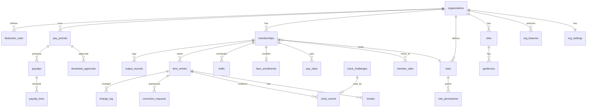

# Workforce system: data model

**Status: draft for review.** Postgres on Supabase, with the PostGIS and `pg_cron` extensions. All times are `timestamptz`; all money is `bigint` in the smallest currency unit.

## Diagram

## Tables

### Businesses and people

| Table | Key columns | Notes |
|---|---|---|
| `organizations` | `id`, `slug` (unique), `name`, `logo_path`, `brand_color`, `is_demo`, `created_at` | One per client business |
| `org_settings` | `org_id` (primary key), `timezone`, `currency`, `week_start`, `pay_frequency`, `grace_minutes`, `regular_minutes_per_day`, `overtime_multiplier`, `default_start_time`, `face_threshold`, `liveness_required`, `location_max_accuracy_m`, `location_mode` (`strict` / `balanced`), `face_fail_policy` / `location_fail_policy` (`block` / `flag`), `keep_audit_frames` | Typed columns with check constraints |
| `org_features` | `org_id`, `feature` (enum), `enabled` | Primary key on both |
| `memberships` | `id`, `org_id`, `user_id` (Supabase Auth user), `display_name`, `employee_code`, `role_id`, `manager_id` (membership), `employment_type` (`regular` / `provisional` / `contract`), `status` (`invited` / `active` / `inactive`), `hired_on` | Unique on `org_id` and `user_id` |
| `roles` | `id`, `org_id`, `name`, `is_default` | Owner, Manager and Employee are created at sign-up |
| `role_permissions` | `role_id`, `permission` (enum) | The fixed permission list is in `SPEC.md` section 4 |
| `invitations` | `id`, `org_id`, `email`, `role_id`, `token_hash`, `expires_at`, `accepted_at` | Token stored hashed |

### Sites and location

| Table | Key columns | Notes |
|---|---|---|
| `sites` | `id`, `org_id`, `name`, `address`, `timezone` (defaults to the business's), `active` | |
| `geofences` | `id`, `site_id`, `kind` (`circle` / `polygon`), `area` (`geography(Polygon, 4326)`), `center` (`geography(Point)`), `radius_m` | A circle is also stored as a polygon, so one check covers both |
| `member_sites` | `membership_id`, `site_id` | Where a member may clock in |

### Time

| Table | Key columns | Notes |
|---|---|---|
| `time_entries` | `id`, `org_id`, `membership_id`, `site_id`, `work_date`, `clock_in`, `clock_out`, `status` (`working` / `on_break` / `closed` / `missing_out`), `break_minutes`, `worked_minutes`, `source` (`app` / `manual`), `edited`, `flagged` | Partial unique index: one open entry per member. Exclusion constraint: no overlapping entries per member |
| `breaks` | `id`, `entry_id` (cascade), `break_start`, `break_end` | |
| `clock_events` | `id`, `org_id`, `entry_id`, `membership_id`, `kind` (`in` / `out` / `break_start` / `break_end`), `server_time`, `location` (`geography(Point)`), `accuracy_m`, `reading_age_s`, `inside_fence`, `distance_to_edge_m`, `location_result`, `face_similarity`, `liveness_passed`, `challenge_id`, `face_result`, `audit_frame_path`, `user_agent` | Append-only evidence |
| `clock_challenges` | `id`, `membership_id`, `actions` (array), `issued_at`, `expires_at`, `used_at` | One use, 60 seconds |
| `face_enrollments` | `membership_id` (primary key), `embedding` (`real[]` or `vector`), `model_version`, `frames_used`, `consent_at`, `enrolled_by`, `enrolled_at`, `expires_at` (demo seats only) | **No select policy for anyone**; read only inside `security definer` functions |
| `embedding_fingerprints` | `membership_id`, `hash`, `seen_at` | Rejects a live embedding identical to one already used |
| `shifts` | `id`, `org_id`, `membership_id`, `site_id`, `starts_at`, `ends_at` | Exclusion constraint: no overlapping shifts per member |
| `correction_requests` | as in `../SPEC.md`, plus `org_id` | Partial unique index: one pending request per entry |
| `change_log` | as in `../SPEC.md`, plus `org_id` | Append-only |
| `output_records` | `id`, `org_id`, `membership_id`, `work_date`, `metric`, `quantity`, `note`, `created_at` | Editable only on its work date |
| `output_targets` | `org_id`, `metric`, `employment_type`, `per_month` | |

### Pay

| Table | Key columns | Notes |
|---|---|---|
| `pay_rates` | `id`, `membership_id`, `basis` (`hourly` / `daily` / `monthly`), `amount_minor`, `effective_from` | Unique on member and date; the rate for a day is the latest on or before it |
| `pay_periods` | `id`, `org_id`, `starts_on`, `ends_on`, `status` (`open` / `in_review` / `locked` / `finalized`), `locked_by`, `locked_at`, `finalized_by`, `finalized_at` | Exclusion constraint: no overlapping periods per business |
| `timesheet_approvals` | `period_id`, `membership_id`, `approved_by`, `approved_at`, `note` | |
| `deduction_rules` | `id`, `org_id`, `name`, `kind` (`fixed` / `percent` / `bracket`), `value`, `brackets` (JSON), `active`, `is_sample` | |
| `payslips` | `id`, `org_id`, `period_id`, `membership_id`, `regular_minutes`, `overtime_minutes`, `late_minutes`, `absent_days`, `gross_minor`, `deductions_minor`, `net_minor`, `status` (`draft` / `final` / `void`), `rates_snapshot` (JSON), `void_reason`, `generated_at` | Unique on period and member while not void |
| `payslip_lines` | `id`, `payslip_id`, `kind` (`earning` / `deduction`), `label`, `quantity`, `rate_minor`, `amount_minor`, `source_entry_ids` (array) | |

### Audit

| Table | Key columns | Notes |
|---|---|---|
| `audit_log` | `id`, `org_id`, `actor`, `action`, `table_name`, `row_id`, `old_value`, `new_value`, `reason`, `at` | Written by triggers on settings, roles, rates, sites and periods. Append-only |

## Functions (the only write path for rules that matter)

| Function | Does |
|---|---|
| `create_organization` | New business, default roles, settings and features; caller becomes owner |
| `has_permission(org, permission)` | Used by every policy |
| `issue_clock_challenge()` | Returns actions, a one-time identifier and the expiry |
| `clock_in(site, location, accuracy, age, challenge, embedding, liveness)` | All checks in `SPEC.md` section 6; writes the entry and evidence |
| `start_break`, `end_break`, `clock_out(...)` | Same evidence rules |
| `enroll_face(member, embeddings[], consent)` | Averages, stores, never returns the embedding |
| `submit_request`, `approve_request`, `reject_request`, `withdraw_request` | Correction flow |
| `admin_edit_entry`, `admin_add_entry`, `admin_delete_entry` | Reason required; change log |
| `approve_timesheet`, `lock_period`, `unlock_period` | Payroll steps |
| `generate_payslips(period)`, `finalize_period(period)`, `void_payslip(id, reason)` | Payroll |
| `close_missing_out()` | Scheduled with `pg_cron` every 15 minutes, per site timezone |
| `reset_demo_data()` | Scheduled nightly; only touches businesses with `is_demo` |

## Views for analytics

`member_day_facts` (one row per member per day: scheduled minutes, worked minutes, late minutes, flags) feeds `member_period_metrics`, `team_period_metrics` and `site_period_metrics`. The views use `security_invoker`, so row-level security applies to whoever reads them.
